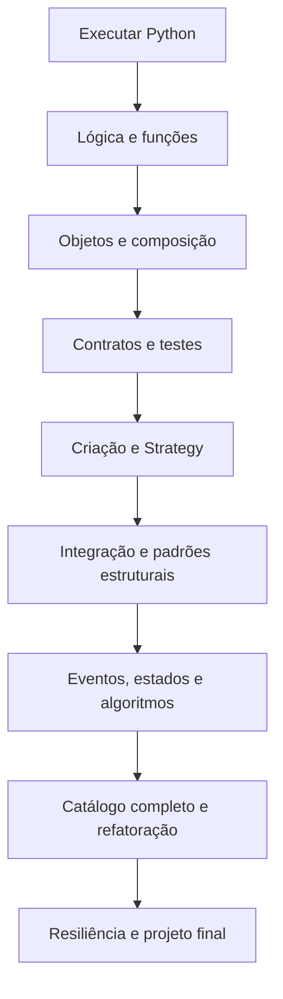
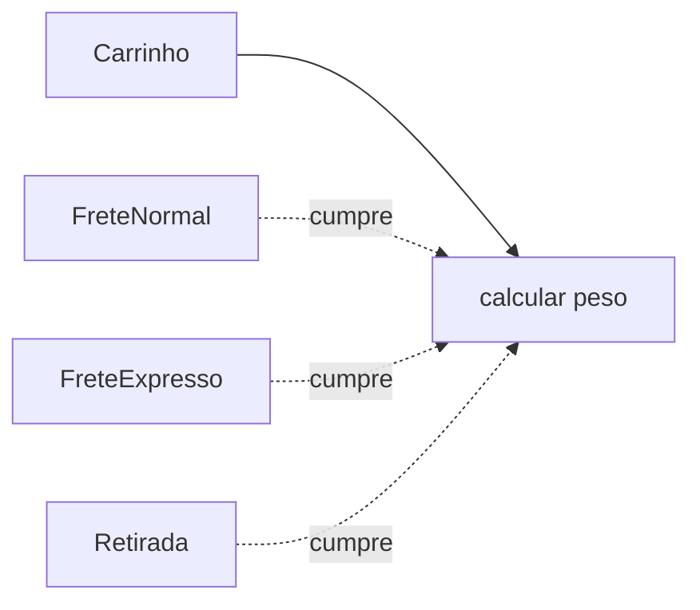
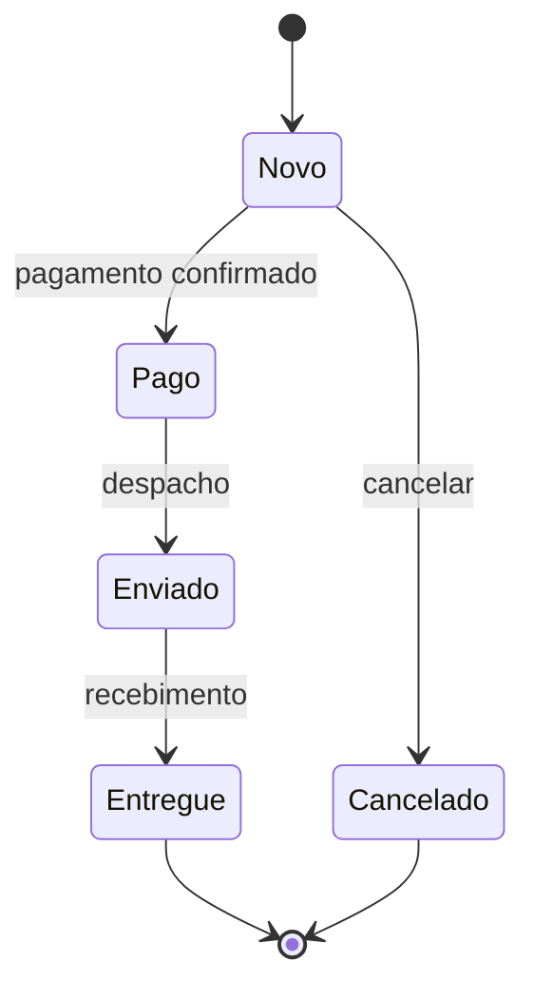
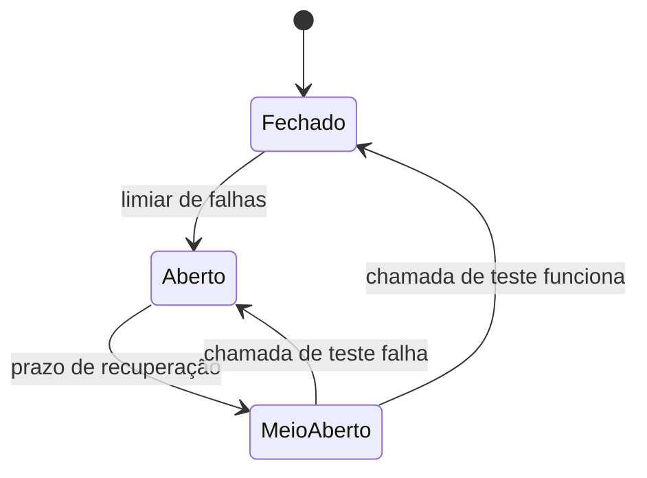

# Design Patterns em Python — do zero ao avançado

Material autoral de estudo • preparado em 14/10/2026 • linguagem escolhida: Python.

## Como usar este caderno

Comece pelo Mundo 0. Faça os exercícios antes de consultar o [gabarito comentado](../03-exercicios/exercicios_e_gabarito.md). Os [vídeos e o registro de acesso](../06-fontes/videos_e_notas.md) complementam a trilha. O [laboratório executável](../04-exemplos/laboratorio_patterns.py) reúne exemplos das etapas intermediárias; não é necessário entendê-lo no primeiro dia.

Este caderno não é uma transcrição dos vídeos. As explicações, os exemplos, o projeto e os desafios foram criados para ensinar os assuntos. Consulte o arquivo de fontes para distinguir conteúdo verificado em legendas de descrições dos autores.

**Objetivo final:** ler um problema, identificar o que varia, escolher uma solução simples, implementar e testar; aplicar um padrão quando ele trouxer um benefício concreto. Conhecer nomes é apenas uma parte do trabalho.

## Seu jogo: Oficina dos Padrões

Você vai construir a **Loja da Guilda**, uma loja fictícia de itens de aventura. Ela começa calculando preços e termina com fretes, pagamento simulado, notificações, estados do pedido e tratamento de falhas. Não usaremos cobrança real, serviços pagos ou dados de clientes.

Cada mundo tem seis missões. Registre XP somente uma vez por missão concluída:

| Missão | Evidência necessária | XP |
|---|---|---:|
| Explicar | Explicar o conceito com suas palavras e uma analogia | 20 |
| Prever | Prever a saída de um exemplo antes de executá-lo | 20 |
| Construir | Implementar o exercício principal sem copiar a solução | 40 |
| Verificar | Conferir três casos: comum, limite e erro | 20 |
| Chefe | Resolver a mudança proposta e justificar a solução | 50 |
| Revisitar | Refazer uma parte de memória após sete dias | 10 |

São **160 XP por mundo**, até **1.920 XP**. Errar não tira pontos. Repetir a mesma tarefa não multiplica XP. A pontuação registra prática; não certifica domínio profissional.

| Faixa | Insígnia |
|---|---|
| 0–319 XP | Aprendiz da oficina |
| 320–639 XP | Explorador de objetos |
| 640–959 XP | Construtor de contratos |
| 960–1.279 XP | Investigador de padrões |
| 1.280–1.599 XP | Guardião dos testes |
| 1.600–1.920 XP | Projetista da guilda |

**Portão de avanço:** conclua Construir, Verificar e Chefe e acerte pelo menos quatro de cinco perguntas de revisão. Se não conseguir, revise apenas a dificuldade e tente um exemplo diferente. XP acumulado não substitui esse portão.

### Ritmo sugerido

Estimativa didática: **128 horas**, aproximadamente 22 semanas de 6 horas ou 32 semanas de 4 horas. Ajuste pelo seu ritmo; os tempos não são promessas.

Uma sessão de 60 minutos: 10 min de recuperação de memória, 15 min de explicação ou vídeo, 25 min de código, 10 min para verificar e registrar uma descoberta. Faça três sessões de construção e uma de revisão por semana; acrescente sessões conforme a disponibilidade.

Revise depois de 1, 3, 7 e 14 dias. Feche o material e responda primeiro: “qual problema havia, o que varia, como resolvi e qual custo introduzi?”.

| Mundo | Tema | Horas | Desbloqueio |
|---|---|---:|---|
| 0 | Preparação e primeiro programa | 2 | Executar e alterar um arquivo |
| 1 | Lógica, funções e coleções | 16 | Calcular e validar entradas |
| 2 | Objetos, composição e contratos | 14 | Trocar uma implementação |
| 3 | Design Patterns, SOLID e testes | 8 | Identificar um problema de manutenção |
| 4 | Simple Factory e os padrões de criação | 10 | Centralizar criação com justificativa |
| 5 | Strategy | 8 | Adicionar um frete sem mudar o consumidor |
| 6 | Adapter, Facade, Decorator e Proxy | 12 | Integrar e envolver componentes |
| 7 | Observer, State e Template Method | 10 | Modelar eventos e transições |
| 8 | Os demais padrões GoF | 8 | Reconhecer todos os 23 e suas diferenças |
| 9 | Refatoração e decisão de projeto | 6 | Simplificar sem alterar comportamento |
| 10 | Retry, circuit breaker e concorrência | 10 | Simular falhas com limites |
| 11 | Projeto final e defesa das escolhas | 14 | Demonstrar comportamento e testes |



Os diagramas Mermaid aparecem em leitores compatíveis. Também há esquemas em texto para estudar sem um renderizador.

## Mundo 0 — fazer o computador seguir uma instrução

**Pré-requisito:** nenhum. **Chefe:** criar um programa que mostre seu nome, o nome da loja e o preço de um item.

Abra um editor de texto, crie uma pasta para o estudo e salve `aula_01.py`. No terminal dessa pasta, confira `python --version`; no Windows, `py --version` é uma alternativa. Se nenhum funcionar, instale Python pelo [site oficial](https://www.python.org/downloads/) e reabra o terminal. Os exemplos usam Python 3.10 ou superior e apenas a biblioteca padrão.

```python
print("Olá, explorador!")
preco = 35
quantidade = 2
total = preco * quantidade
print("Total:", total)
```

Execute `python aula_01.py` ou `py aula_01.py`. A saída esperada termina em `Total: 70`.

`print` exibe um valor. Aspas delimitam texto. `=` associa um nome a um valor; não significa comparação. `*` multiplica. O programa executa essas linhas em ordem: cria os valores, calcula e exibe.

```text
preco = 35 ─────────┐
                   ├── multiplicação ── total = 70 ── print
quantidade = 2 ─────┘
```

**Missões:** explique `=`; preveja o total para quantidade 3; mude o produto; confira quantidade 0, 1 e 3; resolva o chefe; refaça sem olhar. Quantidade zero dá total zero nesse cálculo; decidir se a loja aceita essa compra é uma regra separada.

**Revisão:** o que é uma instrução? O que delimitam as aspas? Qual a diferença entre o nome `total` e seu valor? Em que ordem as linhas executam? O que mudaria se o preço fosse 40?

## Mundo 1 — lógica antes de classes

### 1.1 Valores, decisões e repetições

Use inteiros para contagens, texto para nomes e booleanos para decisões. Para preços nos exercícios, use **centavos inteiros**: 3.500 representa R$ 35,00. Isso evita ensinar arredondamento monetário com `float` logo no começo. Em sistemas reais, moeda, arredondamento e precisão precisam de regras explícitas.

```python
subtotal_centavos = 7000
if subtotal_centavos >= 10000:
    frete_centavos = 0
else:
    frete_centavos = 1200
print(subtotal_centavos + frete_centavos)  # 8200
```

`>=` pergunta se o valor é maior ou igual. O bloco indentado pertence à decisão. Em Python, a indentação faz parte da estrutura. `==` compara valores; `=` faz uma atribuição.

```text
Subtotal >= 10.000?
       ├── sim → frete 0
       └── não → frete 1.200
```

Uma lista guarda uma sequência. Um laço executa uma ação para cada elemento:

```python
precos = [3500, 2000, 1500]
subtotal = 0
for preco in precos:
    subtotal = subtotal + preco
print(subtotal)  # 7000
```

Na primeira passagem, subtotal vira 3.500; na segunda, 5.500; na terceira, 7.000. Depois de entender o percurso, compare com `sum(precos)`.

### 1.2 Funções: dar nome a uma operação

Uma função recebe dados, executa uma operação e pode devolver um resultado. `return` devolve ao chamador; `print` só mostra na tela. Separar cálculo de exibição facilita reaproveitar e verificar o cálculo.

```python
def calcular_total(preco_centavos, quantidade):
    if preco_centavos < 0:
        raise ValueError("Preço não pode ser negativo")
    if quantidade <= 0:
        raise ValueError("Quantidade deve ser positiva")
    return preco_centavos * quantidade

print(calcular_total(3500, 2))  # 7000
```

`def` define a função. Os nomes entre parênteses são parâmetros. Os valores da chamada são argumentos. `raise` sinaliza que não é possível concluir a operação nas condições recebidas; não é uma mensagem de sucesso. Neste estágio, considere entradas inteiras; validação de tipo será um desafio posterior.

### 1.3 Dicionários e mutabilidade

```python
produto = {"nome": "Poção", "preco_centavos": 3500}
print(produto["nome"])
produto["preco_centavos"] = 4000
```

Um dicionário associa chaves a valores. Listas e dicionários podem mudar. Se dois nomes apontam para a mesma lista, uma alteração aparece por ambos. Faça esse experimento antes de estudar Prototype:

```python
a = ["espada"]
b = a
b.append("escudo")
print(a)  # ['espada', 'escudo']
```

**Exercícios:** E01–E05 do caderno de exercícios. **Chefe:** carrinho com três produtos, quantidades positivas, subtotal e frete grátis a partir de 10.000 centavos. Dê nome às funções e mantenha o cálculo independente de `print`.

**Verificação:** total comum, subtotal exatamente 10.000, quantidade inválida. **Revisão:** `return` versus `print`; `=` versus `==`; função versus chamada; lista versus dicionário; erro de entrada versus resultado válido.

Referência para aprofundamento: [tutorial oficial de Python](https://docs.python.org/3.14/tutorial/).

## Mundo 2 — objetos, composição e contratos

### 2.1 Uma classe reúne estado e comportamento

Na loja, cada pedido tem seus próprios itens e operações. A classe descreve a estrutura; cada instância é um pedido específico. `self` se refere à instância que recebe a chamada. `__init__` inicializa seus dados.

```python
class Pedido:
    def __init__(self):
        self._itens = []

    def adicionar(self, preco_centavos, quantidade):
        if preco_centavos < 0 or quantidade <= 0:
            raise ValueError("Item inválido")
        self._itens.append((preco_centavos, quantidade))

    def subtotal(self):
        return sum(preco * quantidade for preco, quantidade in self._itens)

p1 = Pedido()
p2 = Pedido()
p1.adicionar(3500, 2)
print(p1.subtotal(), p2.subtotal())  # 7000 0
```

O `_` em `_itens` indica uma convenção de uso interno; não é uma barreira de acesso. Encapsular é organizar as operações para preservar regras: por exemplo, adicionar através de um método que valida. Não basta renomear um atributo.

**Armadilha:** colocar `_itens = []` diretamente no corpo da classe faria a lista ser compartilhada se as instâncias não a substituíssem. Inicializá-la em `__init__` cria uma lista por pedido.

### 2.2 Composição e herança

Composição significa que um objeto **usa ou contém** outro. Herança estabelece que uma classe **é um tipo de** outra e deve respeitar seu contrato. Não herde apenas para copiar algumas linhas.

```text
Composição: Loja → usa → CalculadoraDeFrete
Herança:    FreteExpresso → é uma implementação de → ContratoDeFrete
```

Se você precisa trocar o cálculo de frete, receber um objeto calculador é uma opção flexível. Se precisa um esqueleto fixo de importação com etapas redefiníveis, herança pode fazer sentido. A decisão depende da relação e das mudanças esperadas.

### 2.3 Polimorfismo e duck typing

Polimorfismo permite usar implementações diferentes através de uma operação comum:

```python
class FreteNormal:
    def calcular(self, peso):
        return 1000 + 200 * peso

class FreteExpresso:
    def calcular(self, peso):
        return 2000 + 400 * peso

def total_com_frete(subtotal, peso, frete):
    return subtotal + frete.calcular(peso)

print(total_com_frete(7000, 2, FreteNormal()))  # 8400
```

Essa função não precisa conhecer a classe concreta: precisa que o objeto forneça `calcular(peso)` e devolva um valor compatível. Esse estilo é chamado de duck typing. Ter o mesmo nome de método não basta: unidades, erros e efeitos também fazem parte do contrato.

Mais adiante, `Protocol` permite descrever estruturalmente operações para verificadores de tipos; `ABC` permite definir métodos abstratos e impedir a instanciação de uma classe incompleta. Anotações de tipo e `Protocol` não validam automaticamente os valores de entrada durante a execução. Veja [typing](https://docs.python.org/3.14/library/typing.html#typing.Protocol) e [abc](https://docs.python.org/3.14/library/abc.html).

**Exercício:** E06. **Chefe:** trocar o frete por um objeto falso que devolve sempre 500, sem mudar `total_com_frete`. **Revisão:** classe versus instância; atributo de classe versus atributo da instância; papel de `self`; composição versus herança; quais regras tornam dois objetos substituíveis?

## Mundo 3 — por que os padrões existem

Um padrão descreve uma solução recorrente para um problema em determinado contexto. Ele orienta a estrutura e as responsabilidades; não é um trecho universal de código para copiar. O catálogo GoF reúne 23 padrões de criação, estrutura e comportamento. Simple Factory é uma técnica de criação conhecida, mas não é um dos 23 padrões desse catálogo.

**Exemplo do problema:** o checkout verifica o tipo do frete, cria seu objeto, calcula o preço, chama o pagamento, salva relatório e envia mensagens. Cada mudança tem chance de afetar etapas que deveriam ser independentes. Primeiro identifique as responsabilidades e o comportamento esperado; depois avalie o padrão.

### SOLID em linguagem concreta

| Princípio | Pergunta útil na loja | Aplicação possível |
|---|---|---|
| S — responsabilidade única | Que mudança de negócio faz este componente mudar? | Separar cálculo de preço da entrega de mensagens |
| O — aberto/fechado | Posso acrescentar uma alternativa sem reescrever seu consumidor? | Outra estratégia de frete respeita `calcular` |
| L — substituição | Esta alternativa cumpre as mesmas promessas? | Um frete não passa a devolver texto ou um valor negativo |
| I — segregação de interfaces | O cliente depende de operações que não usa? | Um leitor de catálogo não precisa poder apagar produtos |
| D — inversão de dependência | A regra central depende de um detalhe externo? | Checkout recebe um cobrador com contrato definido |

Injeção de dependência é fornecer uma colaboração de fora. Inversão de dependência é uma decisão sobre a direção das dependências entre regras e detalhes. É possível injetar uma classe concreta e continuar fortemente acoplado a ela. Nenhum princípio exige criar uma interface para cada função.

### Um teste verifica uma promessa

```python
import unittest

def calcular_total(preco, quantidade):
    if preco < 0 or quantidade <= 0:
        raise ValueError("Entrada inválida")
    return preco * quantidade

class TesteTotal(unittest.TestCase):
    def test_duas_unidades(self):
        self.assertEqual(calcular_total(3500, 2), 7000)

    def test_quantidade_invalida(self):
        with self.assertRaises(ValueError):
            calcular_total(3500, 0)

if __name__ == "__main__":
    unittest.main()
```

Salve esse bloco como `test_total.py` e rode `python -m unittest test_total.py`. O primeiro teste confere uma saída; o segundo confere um erro esperado. Testes de caracterização registram o comportamento de um código existente antes de refatorar. Um comportamento observado pode ser um bug: decida se deve preservá-lo ou alterá-lo como uma mudança separada.

**Vídeos agora:** [Dicionário do Programador](https://www.youtube.com/watch?v=J-lHpiu-Twk) e [SOLID, Clean Code e Design Patterns](https://www.youtube.com/watch?v=yZRd_EWUs1g).

**Exercício:** E07. **Chefe:** escrever três testes para o carrinho antes de reorganizá-lo. **Revisão:** contexto de um padrão; três famílias GoF; custo de uma abstração; contrato; diferença entre refatorar e mudar comportamento.

## Mundo 4 — separar criação de utilização

### 4.1 Simple Factory

**Problema:** vários lugares precisam decidir qual calculador de frete criar. Cada um repete decisões de construção. **Ideia:** centralizar a seleção e a construção. Analogia: um balcão entrega a ferramenta pedida; quem usa não precisa montá-la.

```python
class FreteNormal:
    def calcular(self, peso):
        return 1000 + 200 * peso

class FreteExpresso:
    def calcular(self, peso):
        return 2000 + 400 * peso

def criar_frete(tipo):
    if tipo == "normal":
        return FreteNormal()
    if tipo == "expresso":
        return FreteExpresso()
    raise ValueError("Tipo de frete desconhecido")

frete = criar_frete("normal")
print(frete.calcular(2))  # 1400
```

```text
tipo normal ── criar_frete ── FreteNormal ── calcular(2)
tipo expresso ─ criar_frete ── FreteExpresso ─ calcular(2)
```

O `if` foi concentrado na criação. Acrescentar um tipo ainda exige editar essa fábrica. Isso não torna a técnica inútil: o benefício pode ser simplesmente reduzir duplicação. Para dois objetos triviais usados uma vez, criá-los diretamente pode ser melhor.

### 4.2 Factory Method é outra estrutura

No Factory Method, uma operação do criador usa um método de criação que subclasses podem redefinir. Uma função chamada `factory` não caracteriza, sozinha, esse padrão.

```python
class Entrega:
    def criar_frete(self):
        raise NotImplementedError

    def cotar(self, peso):
        return self.criar_frete().calcular(peso)

class EntregaNormal(Entrega):
    def criar_frete(self):
        return FreteNormal()

print(EntregaNormal().cotar(2))  # 1400
```

A operação `cotar` permanece no criador; `EntregaNormal` decide o produto. Custo: hierarquia adicional e mais indireção. Se a necessidade é apenas selecionar por uma string, Simple Factory pode bastar.

### 4.3 Os outros três padrões de criação

**Abstract Factory:** cria famílias de produtos compatíveis. Uma interface `FabricaTema` cria botão e menu; `TemaClaro` devolve ambos claros e `TemaEscuro` ambos escuros. O cliente pede a família, evitando misturar peças incompatíveis. Exercício: fábrica de equipamento “gelo” cria arma e armadura do mesmo elemento. Chefe: impedir uma combinação inconsistente sem espalhar condicionais. Custo: adicionar um novo tipo de produto pode exigir alterar todas as fábricas.

**Builder:** constrói um objeto em etapas, principalmente quando há configurações e validações complexas. Exemplo: `RelatorioBuilder.adicionar_titulo(...).adicionar_linha(...).construir()`. O builder guarda o trabalho em andamento; `construir` valida e entrega o resultado. Exercício: montar um relatório sem permitir finalizar sem título. Chefe: gerar duas versões sem compartilhar indevidamente listas internas. Para três argumentos claros, um construtor costuma ser suficiente.

**Prototype:** cria a partir de um objeto existente. Exemplo: copiar uma configuração-base de personagem e ajustar seu nome. Exercício: compare `copy.copy` e `copy.deepcopy` numa ficha com lista de itens. Chefe: alterar a cópia sem mudar o original. Custo: cópias profundas podem ser caras e inadequadas para conexões, arquivos ou recursos externos. A política de cópia é parte da solução.

**Singleton:** controla a existência de uma única instância num escopo definido e oferece acesso a ela. Uma instância única num processo não significa uma instância única em toda a aplicação distribuída. Estado compartilhado pode vazar entre testes e exigir sincronização. Exercício: simule dois consumidores alterando uma configuração global e observe a interferência. Chefe: substituir o acesso global por dependências fornecidas explicitamente. Estude para reconhecer os custos; não o use como ponto de partida obrigatório.

**Vídeos:** [Simple Factory](https://www.youtube.com/watch?v=3-ESljj0jgI) e, depois, [riscos do Singleton](https://www.youtube.com/watch?v=E8ey3HjSthg).

**Exercícios:** E08–E09. **Chefe do mundo:** adicionar “retirada” com custo zero e explicar onde houve mudança. **Revisão:** quem decide a criação em Simple Factory? E em Factory Method? O que é uma família? O que fica no Builder antes de construir? Qual o escopo de uma instância única?

## Mundo 5 — Strategy: trocar como uma tarefa acontece

**Problema:** diferentes algoritmos de frete fazem o consumidor crescer com decisões e detalhes. **O que varia:** o algoritmo. **Ideia:** receber uma estratégia que cumpra um contrato comum.

```python
class Carrinho:
    def __init__(self, frete):
        self.frete = frete

    def total(self, subtotal, peso):
        return subtotal + self.frete.calcular(peso)

carrinho = Carrinho(FreteNormal())
print(carrinho.total(7000, 2))  # 8400
carrinho.frete = FreteExpresso()
print(carrinho.total(7000, 2))  # 9800
```

Use as classes de frete do Mundo 4. O carrinho coordena subtotal e frete; a estratégia conhece o cálculo específico. A fábrica pode escolher **qual objeto criar** e Strategy permite usar **qual algoritmo executar**. São responsabilidades diferentes e podem colaborar.



**Python também permite funções:** se as estratégias não têm estado, `total(subtotal, peso, calcular_frete)` pode chamar uma função recebida. Não é preciso uma classe para cada cálculo. Escolha objetos quando estado ou várias operações fizerem parte da colaboração.

**Use quando:** alternativas mudam independentemente, precisam de testes separados ou são escolhidas durante a execução. **Custo:** mais componentes e uma decisão de seleção em algum lugar. Para uma decisão curta e estável, um `if` pode ser a melhor solução.

**Vídeo:** [Strategy](https://www.youtube.com/watch?v=DzlXwgsc_AU). **Exercício:** E10. **Chefe:** acrescentar frete de bicicleta sem editar `Carrinho.total`. Confira peso zero, peso 2 e entrada negativa, definindo claramente a regra para peso zero. **Revisão:** onde fica a seleção? O que permanece no consumidor? Qual contrato todas as estratégias respeitam? Como uma função poderia cumprir esse papel? Qual o custo?

## Mundo 6 — integrar, simplificar, envolver e controlar

### 6.1 Adapter: traduzir uma interface

**Problema:** a loja espera `cobrar(centavos)`, mas um componente existente oferece `pagar(valor_em_reais)`. **Ideia:** envolver esse componente e traduzir a chamada. Analogia: adaptador de tomada.

```python
from decimal import Decimal

class ProvedorLegado:
    def pagar(self, reais):
        return f"SIMULADO: R$ {reais:.2f}"

class AdapterPagamento:
    def __init__(self, legado):
        self.legado = legado

    def cobrar(self, centavos):
        if centavos <= 0:
            raise ValueError("Valor inválido")
        reais = Decimal(centavos) / Decimal(100)
        return self.legado.pagar(reais)

print(AdapterPagamento(ProvedorLegado()).cobrar(8400))
```

```text
Checkout → cobrar(8400) → Adapter → pagar(84.00) → legado
```

Tradução também pode incluir unidade, formato de resposta e exceções. Custo: uma camada para manter e testar. Um fake substitui a dependência em um teste; um adapter integra interfaces diferentes. Nem todo fake é um adapter.

### 6.2 Facade: uma porta de entrada para um subsistema

**Problema:** o cliente precisa conhecer a ordem de reserva, cobrança e geração de comprovante. **Ideia:** fornecer uma operação de maior nível, como `checkout.finalizar(pedido)`.

```text
Cliente → FacadeCheckout.finalizar
                    ├── estoque.reservar
                    ├── cobrador.cobrar
                    └── comprovante.gerar
```

A fachada coordena o caso de uso; regras de estoque continuam no estoque. Ela não deve acumular todos os cálculos e políticas. Facade pode reduzir o acoplamento do cliente sem eliminar a possibilidade de acesso às interfaces especializadas. Não garante atomicidade nem desfaz operações automaticamente. Chefe: simular cobrança que falha e definir o que acontece com a reserva.

### 6.3 Decorator: acrescentar comportamento mantendo o contrato

**Problema:** várias combinações de adicionais geram muitas subclasses. **Ideia:** envolver um objeto e acrescentar comportamento, delegando o restante.

```python
class FreteComSeguro:
    def __init__(self, base):
        self.base = base

    def calcular(self, peso):
        return self.base.calcular(peso) + 500

print(FreteComSeguro(FreteNormal()).calcular(2))  # 1900
```

```text
Carrinho → calcular → ComSeguro → calcular → FreteNormal
                         +500                  1400
                    resultado final: 1900
```

O padrão Decorator não é sinônimo da sintaxe `@decorador` de Python. A sintaxe é um mecanismo da linguagem que pode ser usada para diferentes finalidades. Custo: ordem dos envoltórios pode influenciar o resultado e dificultar rastrear chamadas. Chefe: experimentar seguro fixo e taxa percentual em ordens diferentes e explicar a diferença.

### 6.4 Proxy: controlar acesso ao objeto

**Problema:** carregar o catálogo é caro ou o acesso precisa ser controlado. **Ideia:** oferecer a mesma operação e decidir quando delegar. Um proxy pode fazer carregamento tardio, autorização ou cache.

```text
Cliente → ProxyCatalogo.buscar(id)
               ├── cache presente → devolve valor
               └── cache ausente → CatalogoReal → guarda → devolve
```

Um proxy de cache exige política de validade. Cachear um estoque mutável indefinidamente pode mostrar disponibilidade incorreta. Controle de autorização precisa ser verificado em todas as rotas relevantes. O padrão não resolve esses detalhes sozinho.

| Padrão | Intenção principal | Exemplo |
|---|---|---|
| Adapter | Compatibilizar interfaces | Centavos para API legada |
| Facade | Simplificar uso de um subsistema | Finalizar compra |
| Decorator | Acrescentar comportamento combinável | Seguro no frete |
| Proxy | Controlar acesso ao objeto | Catálogo com cache |

**Vídeos:** [Adapter](https://www.youtube.com/watch?v=Fg1kEjaaBrs), [Facade](https://www.youtube.com/watch?v=4Aq9UHQ5f5Y), [Decorator](https://www.youtube.com/watch?v=7B60j9EGrrU) e [Proxy](https://www.youtube.com/watch?v=el1MtIPXTqo).

**Exercícios:** E11–E14. **Chefe do mundo:** integrar um segundo cobrador simulado pelo mesmo contrato e oferecer seguro sem editar o frete original. **Revisão:** diferença entre as quatro intenções; o que é delegado; tradução de unidade; ordem dos decorators; validade de cache.

## Mundo 7 — eventos, estados e etapas

### 7.1 Observer

**Problema:** ao concluir uma ação, vários interessados precisam saber dela. **Ideia:** registrar observadores e notificá-los. A fonte não precisa conhecer o detalhe de cada reação.

```python
class Eventos:
    def __init__(self):
        self._ouvintes = []

    def inscrever(self, ouvinte):
        self._ouvintes.append(ouvinte)

    def publicar(self, evento):
        for ouvinte in tuple(self._ouvintes):
            ouvinte(evento)

eventos = Eventos()
eventos.inscrever(lambda e: print("Painel recebeu:", e))
eventos.inscrever(lambda e: print("Relatório recebeu:", e))
eventos.publicar("pedido_pago")
```

```text
Evento pedido_pago ───┬── Painel
                     └── Relatório
```

Esse exemplo é **síncrono e em memória**. Se um ouvinte falhar, a exceção interrompe a publicação. Observer não implica uma fila distribuída, entrega garantida ou execução assíncrona. Antes de implementar outra política, decida como lidar com falhas, cancelamento de inscrição e ordem das notificações. Pub/sub com broker tem outras responsabilidades e garantias.

### 7.2 Máquina de estados e State

Uma máquina de estados define estados e transições permitidas. Um mapa é suficiente para muitos fluxos simples:

```python
transicoes = {
    "novo": {"pago", "cancelado"},
    "pago": {"enviado"},
    "enviado": {"entregue"},
    "entregue": set(),
    "cancelado": set(),
}

def transicionar(atual, destino):
    if atual not in transicoes:
        raise ValueError("Estado de origem desconhecido")
    if destino not in transicoes[atual]:
        raise ValueError("Transição proibida")
    return destino
```



O padrão GoF **State** vai além de uma tabela: delega o comportamento a objetos de estado. `EstadoNovo.pagar(pedido)` pode autorizar a ação e trocar o estado; `EstadoEnviado.pagar(pedido)` pode rejeitá-la. Analogia: o mesmo botão de uma máquina faz coisas diferentes conforme o modo atual.

**Strategy versus State:** Strategy troca uma política para uma tarefa; State representa uma situação interna que altera as operações permitidas. Uma máquina de estados pode existir sem implementar o padrão GoF State. Use objetos de estado quando os comportamentos de cada estado crescerem o suficiente para justificar a estrutura.

### 7.3 Template Method

**Problema:** importar formatos distintos repete a mesma sequência geral. **Ideia:** definir o esqueleto numa classe base e deixar etapas específicas para subclasses.

```python
class Importador:
    def executar(self, texto):
        registros = self.ler(texto)
        if not registros:
            raise ValueError("Sem registros")
        return [r.strip().upper() for r in registros]

    def ler(self, texto):
        raise NotImplementedError

class ImportadorLinhas(Importador):
    def ler(self, texto):
        return texto.splitlines()

print(ImportadorLinhas().executar("espada\nescudo"))
```

`executar` fixa a sequência; `ler` varia. Chefe: tratar registros vazios e adicionar um importador por vírgulas preservando a mesma regra de validação. Custo: dependência da hierarquia e risco de subclasses quebrarem as promessas do algoritmo. Se muitas etapas variarem livremente, composição com estratégias pode ser mais adequada.

**Vídeos:** [Observer](https://www.youtube.com/watch?v=mv9JxI85Ac8), [State](https://www.youtube.com/watch?v=OrCgWzpNszk) e [Template Method](https://www.youtube.com/watch?v=j5fGTi8ObK4).

**Exercícios:** E15–E17. **Chefe do mundo:** emitir a notificação somente depois de uma transição válida para pago e rejeitar o envio de um pedido novo. **Revisão:** quem se inscreve; política de falha; máquina versus objetos State; State versus Strategy; etapa fixa versus variável.

## Mundo 8 — completar o catálogo GoF

Você já estudou cinco padrões de criação, quatro estruturais e quatro comportamentais. Abaixo estão os dez restantes. Não é necessário encaixar todos no projeto final: faça pequenos experimentos para entender suas intenções.

### Estruturais restantes

**Bridge — duas dimensões variam independentemente.** Imagine relatórios simples ou detalhados e saídas de texto ou HTML. Em vez de quatro subclasses combinando tudo, `Relatorio` recebe um `Renderizador`. Esquema: `RelatorioDetalhado → renderizador → HTML ou Texto`. Exemplo de operação: `renderizador.titulo(nome)` e `renderizador.linha(valor)`. Missão E18: acrescentar um renderizador sem alterar os tipos de relatório. Custo: outra colaboração. Diferença para Adapter: Bridge organiza variações do projeto; Adapter compatibiliza uma interface existente.

**Composite — folhas e grupos com a mesma operação.** Uma caixa contém itens ou outras caixas; todos oferecem `preco()`. A caixa soma o preço de seus filhos, enquanto a folha devolve seu próprio preço. Esquema: `Caixa → [Poção, Caixa → [Espada, Escudo]]`. Missão E19: calcular uma caixa aninhada e uma caixa vazia. Custo: decidir quais operações fazem sentido para folhas e grupos; impedir ciclos se a estrutura for uma árvore.

**Flyweight — compartilhar dados repetidos.** Mil peças do jogo podem compartilhar o mesmo modelo visual, enquanto cada posição fica fora dele. Separe estado intrínseco, como textura, do extrínseco, como posição. Missão E20: criar uma fábrica de modelos por tipo e contar quantos modelos existem após criar cem peças. Custo: acesso indireto e risco de compartilhar estado mutável que deveria ser individual. Meça a economia antes de otimizar.

### Comportamentais restantes

**Chain of Responsibility — passar uma solicitação entre tratadores.** Uma solicitação de desconto passa por regras que podem tratá-la ou encaminhá-la. Esquema: `cliente → regraCupom → regraFidelidade → regraPadrao`. Defina se a primeira regra que responde encerra a cadeia; essa é a política do exercício E21. Se todas precisarem executar, você pode estar modelando um pipeline de outra natureza. Custo: a ordem altera a resposta e uma solicitação pode ficar sem tratamento.

**Command — representar uma solicitação como objeto.** Um comando `AdicionarItem` guarda receptor e argumentos e oferece `executar()`. Uma fila pode guardar comandos sem conhecer seus detalhes. Missão E22: adicionar `desfazer()` e manter histórico em uma pilha. Custo: mais objetos e lógica de reversão. Desfazer uma operação externa não significa simplesmente rodar o código ao contrário: pode exigir uma compensação.

**Iterator — percorrer sem expor a representação.** O cliente usa `for item in colecao` sem saber como os itens são guardados. Em Python, `__iter__` e geradores oferecem mecanismos diretos para esse papel. Missão E23: gerador de produtos abaixo de um limite. `yield` entrega um valor e suspende a função até a próxima solicitação. Custo: o resultado pode ser consumido uma única vez, e mudanças durante a iteração precisam de política.

**Mediator — centralizar interações entre participantes.** Um formulário tem campos, botão e mensagem; o mediador coordena habilitar o botão conforme os campos mudam. Esquema: `CampoNome → Mediador ← CampoEmail; Mediador → Botao`. Missão E24: componentes notificam o mediador, que atualiza a prontidão. Custo: o mediador pode crescer demais. Diferença para Facade: o mediador coordena relações entre participantes; a fachada oferece uma interface simplificada ao cliente.

**Memento — guardar um estado para restaurar depois.** Um editor produz um retrato de seu conteúdo; o histórico conserva esse retrato sem manipular diretamente o interior do editor. Missão E25: guardar duas versões do carrinho e restaurar a primeira. Custo: memória e política de cópia. Command guarda uma ação; Memento guarda um estado. Podem ser combinados, mas não são equivalentes.

**Interpreter — avaliar uma linguagem pequena.** Nós como `Literal`, `Soma` e `Multiplicacao` representam expressões e oferecem `avaliar()`. Esquema: `Soma(Literal(2), Multiplicacao(Literal(3), Literal(4))) → 14`. Missão E26: construir a árvore diretamente, sem usar `eval`. Não é necessário criar um parser nesta missão. Custo: linguagens maiores exigem outras ferramentas; parsing e avaliação são etapas diferentes.

**Visitor — adicionar operações a uma estrutura de tipos.** Itens físicos e digitais recebem visitantes para relatório ou inspeção. Cada item tem `aceitar(visitante)` e chama a operação apropriada, como `visitar_fisico(self)`. Missão E27: relatório e contagem sobre uma coleção de tipos estáveis. Custo: adicionar um novo tipo de elemento pode exigir alterar todos os visitantes. Em Python, funções ou despacho por tipos podem ser mais simples dependendo do contexto.

### Lista completa para consulta

| Família | Padrões GoF |
|---|---|
| Criação — 5 | Abstract Factory, Builder, Factory Method, Prototype, Singleton |
| Estrutura — 7 | Adapter, Bridge, Composite, Decorator, Facade, Flyweight, Proxy |
| Comportamento — 11 | Chain of Responsibility, Command, Interpreter, Iterator, Mediator, Memento, Observer, State, Strategy, Template Method, Visitor |

Referência do catálogo: [Design Patterns: Elements of Reusable Object-Oriented Software, na editora](https://www.oreilly.com/library/view/design-patterns-elements/0201633612/). As missões e os exemplos da loja são autorais.

**Chefe do mundo:** escolha três padrões pouco familiares, desenhe suas colaborações e resolva as missões correspondentes. Para avançar, explique o problema e uma alternativa simples para cada um dos dez restantes. **Revisão:** família versus intenção; compartilhar estado; ação versus retrato; coleção versus percurso; custo de novos tipos no Visitor.

## Mundo 9 — refatorar com critério

Refatoração altera a organização preservando o comportamento observável acordado. Adicionar uma regra nova é uma mudança funcional. Misturar ambas torna mais difícil entender por que um teste falhou.

Faça este procedimento no checkout:

1. Escreva exemplos de comportamento esperado e testes que os representem.
2. Identifique uma dificuldade concreta: duplicação de construção, regras misturadas ou detalhe externo.
3. Faça a menor extração útil. Uma função nomeada pode ser suficiente.
4. Execute os testes. Corrija antes de continuar.
5. Introduza um padrão se ele melhorar a mudança necessária.
6. Compare: quantos lugares foram editados, o que ficou mais claro e que indireção surgiu?

### Cartão de decisão

Preencha antes de aplicar qualquer padrão:

```text
Problema observado:
Mudança que preciso suportar agora:
O que permanece estável:
O que varia:
Solução simples considerada:
Padrão candidato e motivo:
Custo e possível falha:
Teste que demonstra o benefício:
```

**Exemplo:** “Há dois provedores com nomes de métodos e unidades diferentes. Meu checkout precisa cobrar em centavos. Posso espalhar traduções ou concentrá-las em adapters. Escolho adapters porque o mesmo contrato atende o checkout e os testes. Custo: testar cada tradução; falha possível: unidade incorreta.”

**Cheiro não é sentença:** um `if` não é necessariamente um problema; repetição de duas linhas pode ser aceitável; mais classes não significam melhor projeto. Meça clareza e dificuldade de mudança no caso concreto.

**Exercício:** E28. **Chefe:** retirar uma abstração desnecessária e demonstrar que o comportamento continua correto. **Revisão:** mudança funcional; teste de caracterização; menor extração; benefício demonstrável; custo de uma indireção.

## Mundo 10 — resiliência e limites reais

Reassista [5 Design Patterns Que Todo Dev Deveria Conhecer](https://www.youtube.com/watch?v=9sI8KHEjs0M) agora: ele reúne Strategy, Observer, Adapter, máquina de estados e retry/circuit breaker. Os dois últimos assuntos não são, como conjunto, entradas do catálogo GoF; máquina de estados é um modelo, e State é um padrão que pode implementá-lo.

### Retry: tentar de novo com uma política

Uma falha temporária pode desaparecer. Retry repete a operação de forma limitada. Defina **quantas tentativas no total**, quais erros permitem repetir e quanto esperar. Três tentativas totais significam uma inicial e até duas repetições.

```text
tentativa 1 → falhou → espera 1 s
tentativa 2 → falhou → espera 2 s
tentativa 3 → falhou → encerra com erro
```

Backoff aumenta a espera. Jitter adiciona variação aleatória para reduzir tentativas sincronizadas. Um erro permanente, como um pedido inválido, não se torna válido ao repetir. Veja a [documentação de Retry](https://learn.microsoft.com/en-us/azure/architecture/patterns/retry).

### Circuit breaker: interromper chamadas que tendem a falhar



Fechado permite chamadas; aberto rejeita temporariamente; meio aberto deixa passar uma quantidade limitada para avaliar recuperação. O circuito precisa manter estado entre chamadas dentro do escopo escolhido. Criá-lo novamente em cada chamada perderia a memória das falhas. Separe circuitos por dependências que possam falhar independentemente. Referência: [Circuit Breaker](https://learn.microsoft.com/en-us/azure/architecture/patterns/circuit-breaker).

### Idempotência e efeitos externos

Se uma cobrança demora e o cliente não recebe a resposta, isso não prova que ela não ocorreu. Repetir pode duplicá-la. Uma chave de idempotência identifica a mesma operação lógica; a prevenção de duplicatas precisa funcionar no ponto onde o efeito é registrado. Neste curso, simule a cobrança e mantenha um registro por chave para explorar o problema.

**Concorrência:** duas execuções podem observar um estado antigo e tentar alterá-lo. “Verificar e depois modificar” não é automaticamente uma operação indivisível. Singleton, o GIL ou um dicionário não tornam toda sequência segura. Em sistemas reais, sincronização, transações e restrições de unicidade dependem do recurso usado.

**Testabilidade:** injete uma função de relógio e uma função de espera. Nos testes, avance um relógio falso e registre atrasos; não espere segundos reais. Simule: falha temporária seguida de sucesso, limite esgotado, circuito aberto, recuperação e duplicata da mesma operação.

**Exercícios:** E29–E30. **Chefe:** um serviço falso falha duas vezes e depois responde. Execute com no máximo três tentativas totais; depois simule uma indisponibilidade persistente e confira que o circuito reduz chamadas. **Revisão:** retry versus circuito; tentativas versus repetições; idempotência; escopo do circuito; relógio falso.

## Mundo 11 — a Loja da Guilda completa

### Requisitos do projeto

Construa uma aplicação de terminal, com operações simuladas e módulos que você consiga explicar:

1. Cadastrar pelo menos três produtos, com preço em centavos.
2. Adicionar itens com quantidades inteiras positivas e calcular subtotal.
3. Cotar frete normal, expresso e retirada; oferecer seguro opcional.
4. Escolher um cobrador simulado através de um contrato; integrar um legado com Adapter.
5. Coordenar a compra através de uma operação de checkout.
6. Validar estados novo, pago, enviado, entregue e cancelado.
7. Publicar uma notificação após pagamento aceito; registrar as mensagens em memória.
8. Simular falhas transitórias num componente separado; demonstrar retry e circuit breaker.
9. Evitar efeito duplicado para a mesma chave de operação na simulação.
10. Documentar duas escolhas de padrão e uma escolha deliberada de solução simples.

```text
Terminal
   ↓
Checkout ── usa ── Pedido e regras de estado
   ├── calculador de frete (Strategy; criação opcional por Factory)
   ├── cobrador (Adapter se necessário)
   └── eventos (Observer em memória)

Seguro envolve frete (Decorator)
Falhas são simuladas em um componente com política de resiliência
```

Não use todos os 23 padrões como requisito. O desafio é escolher os que resolvem problemas concretos e manter a alternativa simples quando ela é adequada.

### Entregas e avaliação

| Entrega | Evidência | Pontos de qualidade |
|---|---|---:|
| Comportamento | Fluxo comum e erros com resultado explícito | 30 |
| Verificação | Testes de cálculo, estado, tradução e falha | 25 |
| Projeto | Responsabilidades compreensíveis e contratos coerentes | 20 |
| Defesa | Problema, benefício, custo e alternativa por decisão | 15 |
| Uso | Instruções de execução e exemplos reproduzíveis | 10 |

Para concluir o chefe final: pelo menos 80/100 e nenhum caso de cobrança simulada duplicada, transição proibida aceita ou cálculo incorreto entre os cenários definidos. Essa rubrica é separada do XP de prática.

**Roteiro de demonstração:** carrinho de 7.000 + frete normal de 1.400 = 8.400; com seguro = 8.900; retirada = 7.000. Pagar uma vez; tentar pagar novamente com a mesma chave; tentar enviar antes de pagar; provocar falhas transitórias e persistentes. Documente o que cada teste confirma e o que não cobre.

**Mudanças surpresa:** novo cobrador com interface diferente; frete bicicleta; segundo ouvinte; falha de um ouvinte; relatório com nova saída; cache que precisa invalidar. Implemente três e apresente a justificativa.

**Revisão final:** explique Strategy versus State, Adapter versus Facade, Decorator versus Proxy, Factory Method versus Simple Factory e Observer local versus mensageria distribuída.

## Ordem recomendada dos vídeos

Esta é uma ordem pedagógica autoral, diferente da posição atual na playlist:

1. Dicionário do Programador — Mundo 3.
2. SOLID, Clean Code e Design Patterns — Mundo 3; revisitar no 9.
3. Simple Factory — Mundo 4.
4. Strategy — Mundo 5.
5. Adapter — Mundo 6.
6. Facade — Mundo 6.
7. Decorator — Mundo 6.
8. Proxy — Mundo 6, depois de discutir cache.
9. Observer — Mundo 7.
10. State — Mundo 7.
11. Template Method — Mundo 7.
12. Singleton — depois dos contratos e testes; revisitar no 10.
13. Cinco padrões — uma visão geral no Mundo 3, aprofundamento no 10.

Todos os links individuais e a posição da playlist estão em [vídeos e notas](../06-fontes/videos_e_notas.md). Você pode assistir a uma visão geral cedo sem ter de entender cada trecho de código imediatamente.

## Diário de progresso

Copie uma linha por sessão:

```text
Data:
Mundo e exercício:
O que previ:
O que aconteceu:
Erro ou dificuldade:
O que consigo explicar agora:
XP novo e evidência:
Revisões previstas: +1, +3, +7 e +14 dias
```

- [ ] Mundo 0: executo e altero o programa.
- [ ] Mundo 1: decomponho cálculos e valido entradas.
- [ ] Mundo 2: uso objetos e troco colaboradores.
- [ ] Mundo 3: explico um problema de manutenção e escrevo testes.
- [ ] Mundo 4: diferencio técnicas de criação.
- [ ] Mundo 5: acrescento uma estratégia sem mudar o consumidor.
- [ ] Mundo 6: diferencio integração, simplificação, extensão e controle.
- [ ] Mundo 7: modelo eventos, estados e etapas.
- [ ] Mundo 8: reconheço os 23 padrões e suas intenções.
- [ ] Mundo 9: refatoro e retiro complexidade desnecessária.
- [ ] Mundo 10: simulo limites, falhas e recuperação.
- [ ] Mundo 11: demonstro o projeto e defendo minhas escolhas.

## Sua primeira missão — comece hoje

Digite o programa do Mundo 0. Antes de executar, escreva o resultado esperado. Depois mude `preco` para 40 e `quantidade` para 3. Explique o resultado 120. Por fim, resolva E01 sem olhar o gabarito. Esse é o primeiro passo; classes e padrões virão depois.
